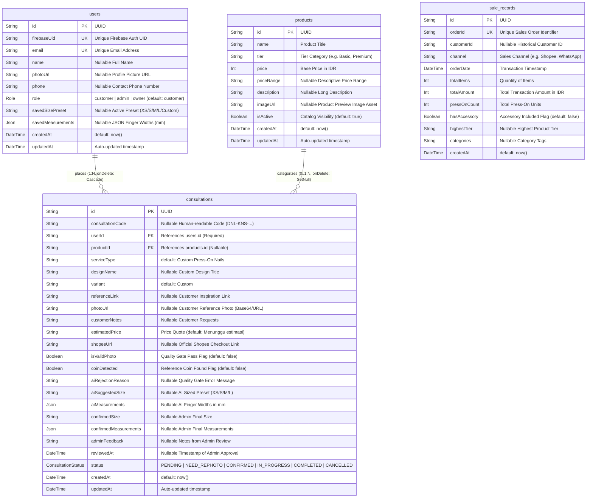

# Database Architecture & Data Dictionary — Dinail.co

This document provides a technical specification of the relational database layer for the Dinail.co backend service, covering hosting topology, entity relationships, referential integrity rules, data dictionaries, and verified design limitations.

---

## 1. Database Overview

* **Database Engine**: PostgreSQL 15+
* **Managed Hosting Platform**: Supabase Cloud (AWS Singapore region `ap-southeast-1`)
* **Object-Relational Mapping (ORM)**: Prisma ORM v6 (`@prisma/client` and `prisma`)
* **Connection Topology**:
  * **Runtime Connection (`DATABASE_URL`)**: Port `6543` using Supabase's transaction pooler (PgBouncer in transaction mode with `?pgbouncer=true`). Optimized for high concurrency, stateless serverless/container requests, and IPv4 compatibility.
  * **Direct Migration Connection (`DIRECT_URL`)**: Port `5432` connecting directly to the PostgreSQL instance session mode. Required by Prisma CLI for executing DDL schema pushes and migrations.

The database serves as the persistent system of record for user profiles, product tiers, custom consultation requests, and audit logs of admin order approvals.

---

## 2. Entity Relationship Diagram (ERD)

The diagram below reflects all models declared in `prisma/schema.prisma` and their physical relationships:

---

## 3. Core Models vs Additional Models

| Model Name | Physical Table Name | Status in Backend API | Operational Role |
|---|---|---|---|
| `User` | `users` | **Active Core** | Manages customer/admin identities, profile data, roles, and default nail sizing presets. |
| `Product` | `products` | **Active Core** | Stores catalog designs, pricing tiers, and active status for customer selection. |
| `Consultation` | `consultations` | **Active Core** | Tracks custom nail order requests, customer reference photos, AI sizing estimations, and admin reviews. |
| `SaleRecord` | `sale_records` | **Unused / Schema-Only** | Defined in `schema.prisma` to model historical offline/marketplace sales data (828 transactions), but has **no API routes or controllers** in the current Express backend. |

---

## 4. Data Dictionary

### A. Model: `User` (`@@map("users")`)
Stores registered customer accounts and administrative staff. Synchronized from Firebase Authentication via `POST /api/v1/auth/sync`.

| Field Name | Type | Modifiers | Default | Purpose & Business Rules |
|---|---|---|---|---|
| `id` | `String` | **PK**, Required | `uuid()` | Internal unique primary key. |
| `firebaseUid` | `String` | **UK**, Required | — | Unique user identifier issued by Firebase Authentication. |
| `email` | `String` | **UK**, Required | — | User email address. Must be unique across all accounts. |
| `name` | `String` | Nullable | `null` | Display name from Google Profile or user update. |
| `photoUrl` | `String` | Nullable | `null` | Profile avatar image URL from Google Profile. |
| `phone` | `String` | Nullable | `null` | Contact WhatsApp / phone number. |
| `role` | `Role` (Enum) | Required | `customer` | Access tier: `customer`, `admin`, or `owner`. |
| `savedSizePreset`| `String` | Nullable | `null` | Customer's preferred standard size preset (`XS`, `S`, `M`, `L`, `Custom`). |
| `savedMeasurements`| `Json` | Nullable | `null` | Structured JSON storing individual finger widths in mm (e.g. `{ "thumb": 16, "index": 12, ... }`). |
| `createdAt` | `DateTime` | Required | `now()` | Account creation timestamp. |
| `updatedAt` | `DateTime` | Required | `@updatedAt` | Automatic timestamp of last profile modification. |

---

### B. Model: `Product` (`@@map("products")`)
Stores press-on nail designs offered in the catalog.

| Field Name | Type | Modifiers | Default | Purpose & Business Rules |
|---|---|---|---|---|
| `id` | `String` | **PK**, Required | `uuid()` | Product primary key. |
| `name` | `String` | Required | — | Name of nail design (e.g., "Classic Glossy Nude"). |
| `tier` | `String` | Required | — | Tier classification (e.g., "Basic Tier", "Signature Tier"). |
| `price` | `Int` | Required | — | Fixed base price in Indonesian Rupiah (IDR). |
| `priceRange` | `String` | Nullable | `null` | Human-readable price estimate range (e.g., "Rp 65.000 - Rp 80.000"). |
| `description` | `String` | Nullable | `null` | Product details and finish description. |
| `imageUrl` | `String` | Nullable | `null` | Relative or absolute path to catalog preview asset. |
| `isActive` | `Boolean` | Required | `true` | Catalog visibility toggle. `findMany` filters by `isActive: true`. |
| `createdAt` | `DateTime` | Required | `now()` | Record creation timestamp. |
| `updatedAt` | `DateTime` | Required | `@updatedAt` | Automatic last update timestamp. |

---

### C. Model: `Consultation` (`@@map("consultations")`)
Core transactional entity representing custom press-on nail consultations and orders.

| Field Name | Type | Modifiers | Default | Purpose & Business Rules |
|---|---|---|---|---|
| `id` | `String` | **PK**, Required | `uuid()` | Internal unique identifier. |
| `consultationCode` | `String` | Nullable | `null` | Business tracking code (e.g., `DNL-KNS-20261127-14`). |
| `userId` | `String` | **FK**, Required | — | References `users.id`. Enforces `onDelete: Cascade`. |
| `productId` | `String` | **FK**, Nullable | `null` | References `products.id`. Enforces `onDelete: SetNull`. |
| `serviceType` | `String` | Nullable | `"Custom Press-On Nails"` | Service category identifier. |
| `designName` | `String` | Nullable | `null` | Name of custom design requested by customer. |
| `variant` | `String` | Nullable | `null` | Selected variant or finish option. |
| `referenceLink` | `String` | Nullable | `null` | Customer-provided reference URL (Instagram/Pinterest). |
| `photoUrl` | `String` | Nullable | `null` | Uploaded reference photo (Base64 data URL or storage link). |
| `customerNotes` | `String` | Nullable | `null` | Customer requests regarding color, shape, or length. |
| `estimatedPrice`| `String` | Nullable | `"Menunggu estimasi"` | Price quote displayed to the customer. |
| `shopeeUrl` | `String` | Nullable | `null` | Official Shopee checkout URL entered by admin upon approval. |
| `isValidPhoto` | `Boolean` | Required | `false` | AI Quality Gate flag indicating whether photo passed blur/lighting checks. |
| `coinDetected` | `Boolean` | Required | `false` | AI Computer Vision flag indicating reference coin was identified. |
| `aiRejectionReason`| `String` | Nullable | `null` | AI Quality Gate error explanation if photo was rejected. |
| `aiSuggestedSize` | `String` | Nullable | `null` | Preset recommended by AI model (e.g., `"M"`). |
| `aiMeasurements` | `Json` | Nullable | `null` | JSON payload of AI-calculated finger widths in mm. |
| `confirmedSize` | `String` | Nullable | `null` | Final nail size confirmed by store admin. |
| `confirmedMeasurements` | `Json` | Nullable | `null` | JSON payload of final admin-adjusted measurements. |
| `adminFeedback` | `String` | Nullable | `null` | Feedback message provided by admin to the customer. |
| `reviewedAt` | `DateTime` | Nullable | `null` | Timestamp when admin reviewed and updated status. |
| `status` | `ConsultationStatus` (Enum) | Required | `PENDING` | Order lifecycle status. |
| `createdAt` | `DateTime` | Required | `now()` | Submission timestamp. |
| `updatedAt` | `DateTime` | Required | `@updatedAt` | Automatic last update timestamp. |

---

### D. Model: `SaleRecord` (`@@map("sale_records")`) — Schema Only
Archival model present in Prisma schema representing historical sales data. Currently has no API routes or controller logic.

| Field Name | Type | Modifiers | Default | Purpose |
|---|---|---|---|---|
| `id` | `String` | **PK**, Required | `uuid()` | Primary key. |
| `orderId` | `String` | **UK**, Required | — | Unique external sales transaction ID. |
| `customerId` | `String` | Nullable | `null` | External customer identifier (unconstrained string). |
| `channel` | `String` | Required | — | Sales channel name (e.g., `"Shopee"`, `"Manual"`). |
| `orderDate` | `DateTime` | Required | — | Date of sale. |
| `totalItems` | `Int` | Required | — | Item count. |
| `totalAmount` | `Int` | Required | — | Transaction monetary value in IDR. |
| `pressOnCount` | `Int` | Required | — | Number of press-on nail sets sold. |
| `hasAccessory` | `Boolean` | Required | `false` | Indicator if application accessories were included. |
| `highestTier` | `String` | Nullable | `null` | Highest tier product included in the transaction. |
| `categories` | `String` | Nullable | `null` | Category descriptor string. |
| `createdAt` | `DateTime` | Required | `now()` | Record insertion timestamp. |

---

## 5. Enums

### `Role`
Defines role-based access control tiers:
* `customer`: Standard end-user. Restricted to self-consultations and public catalog.
* `admin`: Store administrator. Authorized to view all consultations, update status, set prices, and attach Shopee checkout links.
* `owner`: Business owner. Retains all admin privileges.

### `ConsultationStatus`
Tracks the lifecycle of custom nail orders:
* `PENDING`: Initial state upon submission. Awaiting administrative review.
* `NEED_REPHOTO`: Rejected by AI quality gate or admin due to blurry photo / missing coin.
* `CONFIRMED`: Approved by admin with confirmed price and Shopee checkout link.
* `IN_PROGRESS`: Order is actively being manufactured by the nail artist.
* `COMPLETED`: Finished press-on nails shipped or delivered.
* `CANCELLED`: Cancelled by customer or rejected by admin.

---

## 6. Referential Integrity & Deletion Constraints

* **`users` -> `consultations` (`onDelete: Cascade`)**:
  When a user record is deleted from PostgreSQL, all associated consultations submitted by that user are automatically deleted. This ensures no orphaned consultation rows remain.
* **`products` -> `consultations` (`onDelete: SetNull`)**:
  When a product is deleted from the catalog, any consultation referencing that product retains its consultation history, but its `productId` foreign key is set to `NULL`.
* **Unique Constraints**:
  * `users.firebaseUid`: Prevents duplicate accounts linked to the same Firebase identity.
  * `users.email`: Ensures unique email addresses across all accounts.
  * `sale_records.orderId`: Prevents duplicate order log entries.

---

## 7. Verified Database Design Limitations

1. **Unstructured JSON Sizing Data**:
   `savedMeasurements`, `aiMeasurements`, and `confirmedMeasurements` use PostgreSQL `Json` columns without database-level schema constraints. While flexible, validation of finger keys (`thumb`, `index`, `middle`, `ring`, `pinky`) is enforced in application code rather than via database `CHECK` constraints.
2. **Direct Base64 Image Storage**:
   `consultations.photoUrl` stores reference images as text. When users upload Base64 data URLs directly, PostgreSQL row sizes increase significantly. Storing public URLs pointing to a dedicated Supabase Storage bucket (`nail-photos`) is recommended for production scale.
3. **Unindexed Custom Code Lookup**:
   `consultations.consultationCode` is used in `PATCH /consultations/:id` queries alongside `id`, but is not declared as `@unique` or indexed in `schema.prisma`. It currently relies on table scan via `findFirst`.
4. **Disconnected `SaleRecord` Model**:
   `SaleRecord` has no foreign key relationships linking to `User` or `Product`, functioning purely as an isolated historical table without API exposure.
